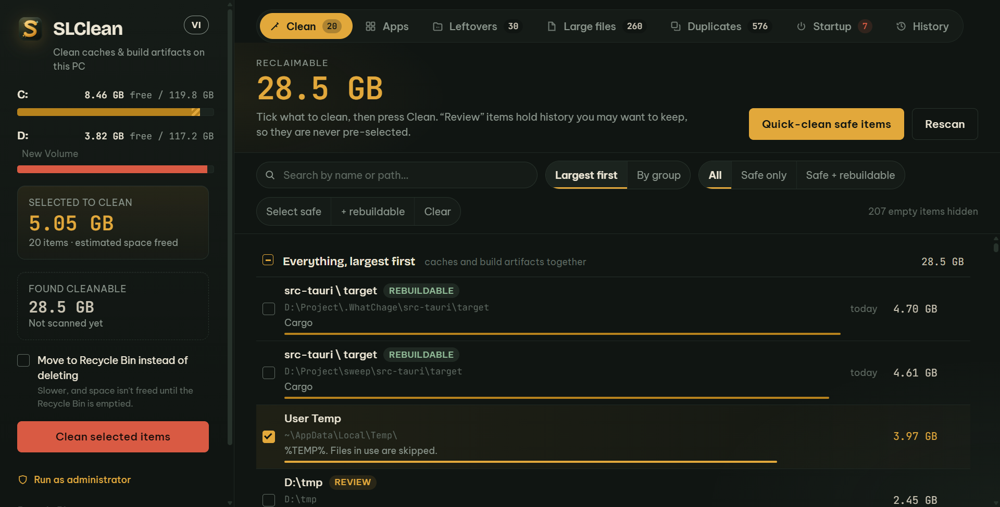
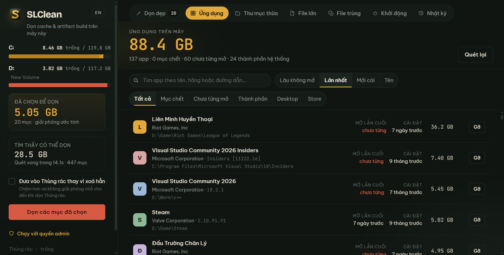
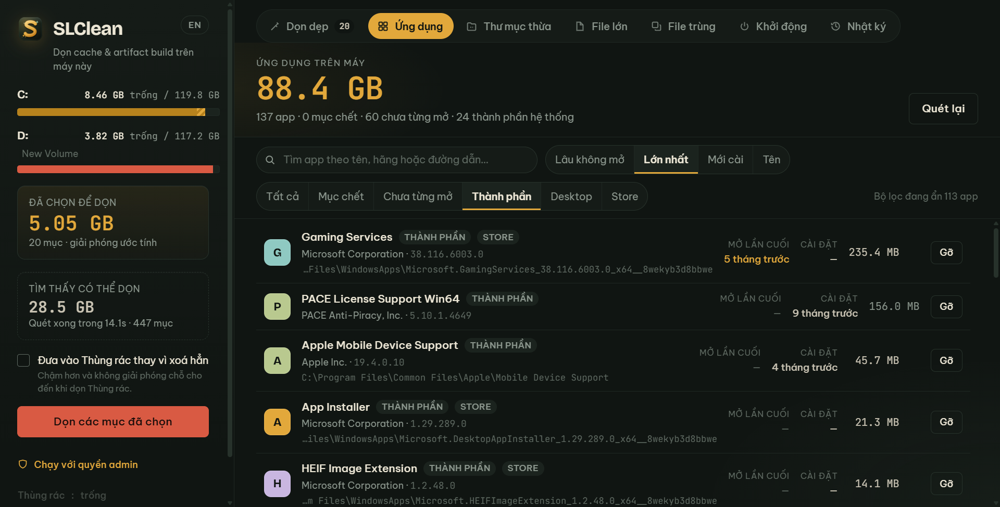
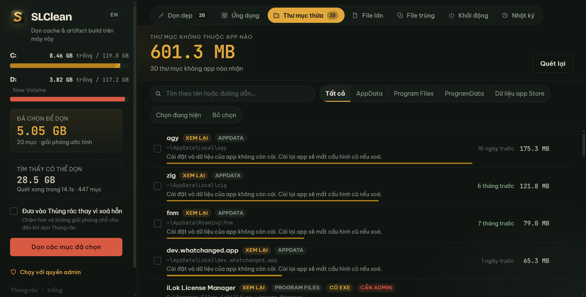
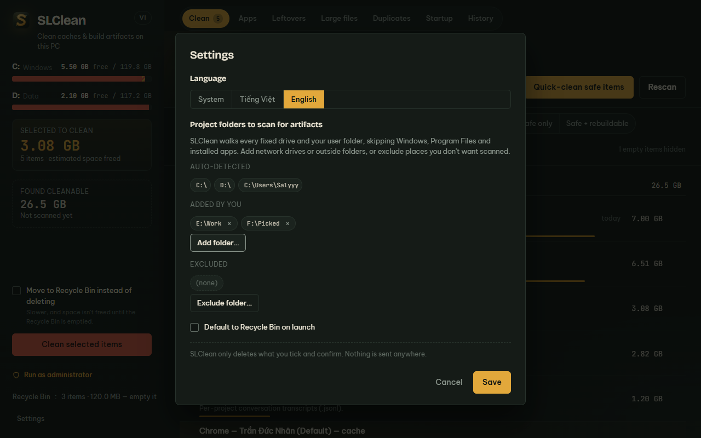

# SLClean

**Local-first Windows disk inspector, AI/developer cache cleaner, and system maintenance utility built with Rust and Tauri 2.**

[Tiếng Việt (README.vi.md)](README.vi.md) | [Download Latest Windows Release](https://github.com/SalyyS1/SLClean/releases) | [Interactive Cache Footprint Explorer](https://salyys1.github.io/SLClean/)

See what actually occupies your Windows drives and reclaim gigabytes without guessing: AI and developer tool caches, project build artifacts, applications you haven't opened in months, orphaned folders left behind by uninstallers, your heaviest single files, byte-identical duplicates, Windows startup entries, and a scan diff journal that shows exactly what grew since your last check.

SLClean ships with a bilingual English/Vietnamese interface (switchable live without restarting), zero ads, zero telemetry, zero outbound network requests, and one strict rule: **nothing is ever deleted automatically**. You inspect the measured sizes, tick what you want removed, and confirm.

### Download for Windows (x64)

Grab the latest build from [GitHub Releases](https://github.com/SalyyS1/SLClean/releases):

- **`SLClean_<version>_x64-setup.exe`**: Per-user NSIS installer (requires no administrator rights).
- **`SLClean-portable.exe`**: Standalone single binary that runs directly with zero installation.

*Note: Release binaries are currently unsigned, so Windows SmartScreen will prompt on first launch. Click **More info -> Run anyway** after verifying the release source or `SHA256SUMS.txt`.*



## Seven Integrated Tabs

| Tab | What It Does |
|---|---|
| **Clean** | Scans developer, AI, browser, app, game, and Windows caches alongside project build artifacts across all drives, measuring real disk usage and tagging every item by safety level. |
| **Apps** | Lists every installed desktop and Microsoft Store app with real measured folder sizes and Windows last-opened dates. Launches official uninstallers or removes dead registry entries that Windows Settings cannot clear. |
| **Leftovers** | Finds orphaned folders inside `AppData`, `ProgramData`, `Program Files`, and `Local\Packages` unclaimed by any installed app or active process. |
| **Large Files** | Walks all drives in a single pass to surface individual files above your size threshold alongside a three-level directory usage map. |
| **Duplicates** | Groups files that are identical byte for byte (size -> first 4 KB -> streaming SHA-256) so you can decide which copy to keep. |
| **Startup** | Displays Windows startup entries from Registry `Run` keys, Startup folders, and Scheduled Tasks with non-destructive on/off toggles. |
| **History** | Records a size snapshot after each scan and diffs any two snapshots to highlight what grew, shrank, or newly appeared. |

The persistent left rail displays free space per fixed drive, your live selected byte total, the Recycle Bin mode toggle, live Recycle Bin size (with one-click empty), and a single **Clean selected items** action shared across **Clean**, **Leftovers**, **Large Files**, and **Duplicates**.

---

## 1. Clean (Caches, AI Tooling & Build Artifacts)

The hero counter displays total reclaimable space found on the machine, while the left rail tracks only what you have ticked. During a scan, rows stream in live with a `measuring` badge as directories are walked in parallel, then automatically record a snapshot for the **History** journal upon completion.

### Views & Filtering

- **`Largest first` (default):** Combines caches and project build artifacts into one flat ledger sorted by descending byte size. Switch to **`By group`** to inspect items organized by tool category.
- **Instant search:** Filter by tool name, directory path, or description; press `Esc` to clear.
- **Safety filters:** Toggle **`Safe only`** or **`Safe + rebuildable`** to hide higher-caution rows. Already ticked items are never hidden by filters, and zero-byte entries are collapsed automatically with a count indicator.
- **Quick selection:** **`Quick-clean safe items`** selects visible safe caches and opens the confirmation dialog immediately. **`Select safe`** and **`+ rebuildable`** operate strictly within the currently visible filter scope and skip locked admin items.

### Safety Classification

| Badge | Meaning | Pre-Selected by Quick Safe? |
|---|---|---|
| *(unlabeled / Safe)* | Pure cache that applications recreate automatically on next run | Yes |
| `rebuildable` | Re-downloaded or recompiled when needed (`npm install`, `cargo build`, Gradle dependencies) | No |
| `review` | Contains user session data, AI conversation transcripts, backups, or personal temp files | Never |
| `needs admin` | System-owned cache requiring elevation; checkbox stays locked until relaunched as administrator | No |
| `partial` | Contains subdirectories unreadable without higher permissions, so measured size is a lower bound | N/A |

### Comprehensive Detection Catalog

SLClean contains zero hardcoded machine paths. Every location is resolved dynamically from Windows environment variables (`%LOCALAPPDATA%`, `%APPDATA%`, `%TEMP%`, `%SystemRoot%`, `%ProgramData%`) and developer toolchain variables (`CARGO_HOME`, `GRADLE_USER_HOME`, `GOPATH`, `GOCACHE`, `PIP_CACHE_DIR`, `UV_CACHE_DIR`, `PLAYWRIGHT_BROWSERS_PATH`). Non-existent paths are omitted silently.

- **AI & LLM Tooling:** `Claude Code` (session transcripts, file-history, shell snapshots, debug logs, todo lists, paste cache, temp), `Codex CLI` (sessions, logs, archived runs), `Antigravity` and `Gemini CLI` (temp and diagnostic logs), `Aider`, `Continue.dev`, `Orca`, `Cursor` and `Windsurf` background updater caches, `Hugging Face` Hub and `KaggleHub` model/dataset caches, `PyTorch`, `vLLM` and `Triton` GPU kernel caches, `ONNX Runtime`, `Weights & Biases`, `tiktoken`, `Ollama`, `LM Studio`, `Playwright` browser binaries, `Puppeteer`, and `chrome-devtools-mcp`.
- **Package Managers & Compilers:** `npm`, `pnpm`, `Yarn`, `Bun`, `Deno`, `pip`, `uv`, `Poetry`, `Ruff`, `pre-commit`, `Turborepo` / `Nx`, `Cargo` (registry cache/src and git checkouts), `rustup` downloads, `Go` (`GOMODCACHE` and `GOCACHE`), `Gradle` (caches, daemon logs, wrapper distributions, auto-provisioned JDKs), `Maven`, `NuGet`, `Composer`, `Dart/Flutter pub`, `Scoop`, `Android`, `Electron`, `node-gyp`, `Cypress`, `Unity`, and `Unreal Engine DDC`.
- **IDEs & Code Editors:** Automatically discovers every VS Code family editor via `User\workspaceStorage` (`VS Code`, `VS Code Insiders`, `Cursor`, `Windsurf`, `Trae`, `Kiro`, `VSCodium`, `Positron`, `Void`, `PearAI`), covering caches, downloaded VSIX extensions, logs, `workspaceStorage`, and local file history, plus `Zed` logs/language runtimes and per-product `JetBrains` directories under `%LOCALAPPDATA%\JetBrains`.
- **Web Browsers (Per-Profile):** Enumerates individual profiles of `Chrome` (Stable, Beta, Canary), `Edge`, `Brave`, `Vivaldi`, `Chromium`, `Arc`, `Coc Coc`, and `Opera` / `Opera GX` using profile names parsed from `Local State` (`Cache`, `Code Cache`, `GPUCache`, `DawnCache`, `Service Worker`), alongside `Firefox`, `Zen`, `Floorp`, `LibreWolf`, and `Waterfox` (`cache2`, `startupCache`, `thumbnails`). Browser logins, saved passwords, cookies, and bookmarks live outside these cache folders and are never touched.
- **Desktop & Microsoft Store Apps:** Dynamically detects Electron apps storing `Cache` + `Code Cache` under `Roaming` or `Local` (`Discord`, `Claude Desktop`, `Slack`, `Figma`, `Notion`, `Blockbench`, `Termius`), plus `Spotify`, `Telegram`, `Zoom`, `OneDrive` logs, `Adobe` media cache, `Remote Desktop`, and Microsoft Store app caches (`TempState`, `AC\INetCache`).
- **Games & Launchers:** `Steam` (shader caches across all library folders parsed from `libraryfolders.vdf`, incomplete downloads, web cache), `Minecraft` launcher (webcache, logs, assets/libraries, versions), `Modrinth`, `Prism Launcher`, and `Epic Games`.
- **Windows & GPU Caches:** User `%TEMP%`, `Windows\Temp`, Windows Update Downloads, Delivery Optimization, CBS logs, Windows Error Reporting (`WER`), CrashDumps, `D3DSCache`, `NVIDIA` / `AMD` / `Intel` GPU shader caches, extracted NVIDIA driver installers, `INetCache`, Explorer thumbnail caches, and Visual Studio `Package Cache`.
- **Root & Home Temp Folders:** `tmp`, `temp`, `*-temp`, `tmp-*` (tagged `review`), `OneDriveTemp` / `WUDownloadCache` / `DeliveryOptimization` (safe), and `$WinREAgent` / `$WINDOWS.~BT` / `Windows.old` (tagged `review` + `needs admin`).
- **Project Build Artifacts:** Walks all fixed drives and user folders to locate `node_modules`, `target` (verified beside `Cargo.toml` or `pom.xml`), `build`, `out`, `dist`, `.NET` `bin`/`obj`, `.venv`, `__pycache__`, `.next`, `.nuxt`, `.astro`, `.wrangler`, `.vercel`, `.turbo`, `.terraform` (beside `*.tf`), `.zig-cache` / `zig-out` (beside `build.zig`), `.gradle`, `.kotlin`, Unity `Library`/`Temp`, `cmake-build-*`, and Paper server test `run` directories. Every match requires a sibling project manifest so folders that merely share a name are never flagged. Node version managers (`nvm`, `fnm`), installed Electron bundles (`resources\app`, `.asar.unpacked`), `msys`, `Program Files`, `Windows`, `Steam`, and `OneDrive` are strictly excluded.

---

## 2. Apps (Installed Software & Last-Opened Telemetry)



Enumerates every application registered with Windows across all three `Uninstall` registry hives (`HKLM` 64-bit, `HKLM` 32-bit, `HKCU`) and current-user Microsoft Store packages (`AppModel\Repository\Packages`, resolving `ms-resource:` indirect names via `SHLoadIndirectString`). Each row displays publisher, version, install date, **real measured install folder size** (falling back to installer estimates only when no folder is recorded), and **Last opened** date. Sort by `Least used`, `Largest`, `Newest`, or `Name`.

To determine when an app was last opened without requiring administrator privileges, SLClean decodes Windows `UserAssist` records in `HKCU` (ROT13-encoded keys and Known Folder GUID prefixes) and parses Start Menu, Taskbar, and Desktop `.lnk` binary files directly via the `MS-SHLLINK` format (without slow COM instantiation) to map `AppUserModelID` -> executable -> install directory. Currently running apps are flagged live via process enumeration.

### Background System Component Separation

Runtimes, redistributables, SDKs, drivers, services, and codecs are automatically separated from regular user apps when their name matches component keywords **and** no Start Menu, Taskbar, or Desktop shortcut points into their install folder (keeping launchable tools like `Visual Studio Installer` in the main list while moving non-interactive redistributables out of `Never opened`):



- **Uninstall:** Always invokes the vendor's official uninstaller (or `Remove-AppxPackage` for Store apps), waits for completion, re-checks the registry, and offers to clean up any leftover install folder.
- **Dead entries:** Identifies registry entries whose uninstaller executable was already deleted manually (which Windows Settings fails to remove) and lets you delete the stale registry key cleanly (`msiexec` product-code entries are never treated as dead).

---

## 3. Leftovers (Orphaned App Folders)



Scans top-level folders inside `AppData\Local`, `Roaming`, `LocalLow`, `ProgramData`, `Program Files (x86)`, `Local\Programs`, and `Local\Packages` that **no installed application claims**: no registered install location points there, normalized folder names match no installed app, publisher, Store package, or executable launched in the last six months, and no running process originates inside them. Built-in Windows folders, developer toolchains, and paths already covered by the **Clean** tab are excluded.

Each row highlights its parent area, flags **`has exe`** when executables are present (for example, a portable app you still use), and shows any historical Windows launch timestamp so you can inspect unfamiliar folders in Explorer before ticking them.

---

## 4. Large Files (Single-Pass Heavy Files & Folder Map)

Cache ledgers measure whole directories, meaning a forgotten 4 GB `.iso` or `.zip` sitting in `Downloads` would otherwise stay invisible. The **Large Files** tab walks your drives in a single background pass (cancellable at any time) and produces two views:

- **File list:** Every individual file at or above your size threshold (default `100 MB`, adjustable).
- **By folder:** A three-level directory usage map summing all files (including small ones) so you can trace where disk space went.

Because these are your personal files rather than cache junk, **nothing is pre-selected**. Windows-managed system files (`pagefile.sys`, `hiberfil.sys`, `swapfile.sys`, `dumpstack.log`) as well as **WSL2 and Docker virtual disks** (`ext4.vhdx`, `docker_data.vhdx`, `swap.vhdx`) are shown so missing gigabytes are accounted for, while locking their checkboxes (and blocking deletion in `cleaner.rs`) with guidance on compacting sparse VHDX disks safely via `wsl --shutdown` + `Optimize-VHD` or adjusting Windows virtual memory. Because the scanner walks standard filesystem APIs instead of requiring raw NTFS Master File Table elevation, it works without administrator rights and supports external and network drives.

---

## 5. Duplicates (Byte-Identical 3-Stage Hashing)

Groups files that are **100% identical byte for byte**, never guessing from filenames or fuzzy image similarity:

1. **Exact byte size:** Unique file sizes are discarded immediately without reading file contents.
2. **First 4 KB hash:** Quickly eliminates same-size files with different headers.
3. **Streaming full-file SHA-256:** Reads candidate files in fixed chunks so multi-gigabyte archives or videos never spike RAM usage (default minimum size `1 MB`, configurable).

Directories where duplicate files exist by design are skipped automatically: developer package stores and VCS trees (`node_modules`, `.git`, `.cargo`, `.gradle`, `.m2`, `.nuget`, `.venv`) as well as application-managed system roots (`Program Files`, `ProgramData`, `AppData`, `Windows`), where deleting individual shared DLLs or side-by-side browser runtimes breaks installed software.

SLClean **never selects a copy for you**. Badges such as `oldest`, `newest`, and `same folder` serve purely as visual hints, and selecting every copy in a group triggers an explicit data-loss warning before cleanup.

---

## 6. Startup (Non-Destructive Boot & Logon Control)

Collects startup programs from three Windows sources: Registry `Run` keys (`HKCU`, `HKLM`, `HKLM WOW64`), user and machine `Startup` folders, and Scheduled Tasks configured with logon or boot triggers. Each row shows the exact command string, source location, and last-opened date when available.

Toggling an entry **Off** is completely non-destructive and 100% compatible with Windows Task Manager: SLClean writes standard `Explorer\StartupApproved\*` flags for Registry/Startup entries and invokes `schtasks /Change` for scheduled tasks, leaving the underlying registration intact so you can re-enable it anytime. Entries whose target file no longer exists on disk are flagged **`broken`** with a dedicated **`Delete entry`** button, while built-in `\Microsoft\` system tasks are hidden to prevent accidental OS breakage.

---

## 7. History (Scan Diff Journal)

After every completed scan, SLClean saves a compact snapshot recording per-drive free space and the measured byte size of every catalog item (`%APPDATA%\vn.salyyy.slclean\history.json`, retaining up to 60 snapshots and coalescing rescans within the same hour). Pick any two snapshots and filter by **`Grew`**, **`Shrank`**, or **`New`** to see what quietly consumed gigabytes since last week.

---

## Settings, Safety Guarantees & Administrator Mode



### Safety Guarantees

- **Zero automatic deletion:** Scanning is strictly read-only. Nothing is moved or deleted until you tick items and confirm in the review dialog. Selection batches containing `review` items display an explicit warning banner.
- **Recycle Bin by default:** Toggle **Move to Recycle Bin instead of deleting** in the left rail (and set it as your launch default in Settings). Recycle Bin queries and emptying use single native Win32 shell calls (`SHQueryRecycleBin` / `SHEmptyRecycleBin`).
- **Hardcoded backend path guard:** Even if a path were passed to the backend directly, `cleaner.rs` unconditionally refuses drive roots, `%SystemRoot%`, `Program Files` roots and Windows/Microsoft/runtime subdirectories inside them, `ProgramData` root, user home roots and core profile directories, `.ssh`, developer tool homes (`.cargo`, `.gradle`, `.claude`), and `WindowsApps`.
- **Graceful lock handling:** Files currently held open by running apps are skipped cleanly and reported in the completion summary without aborting the rest of the cleanup.
- **100% local & offline:** Settings (`settings.json`) and scan history (`history.json`) live locally under `%APPDATA%\vn.salyyy.slclean\`. No analytics, crash uploads, or network calls exist.

### Administrator Mode

Clicking **`Run as administrator`** in the bottom-left corner relaunches SLClean elevated via Windows UAC and hands off cleanly from the non-elevated instance (`--after-pid`). While running as a standard user, system-scoped items (`Windows\Temp`, Windows Update caches, `Windows.old`, `HKLM` dead entries, machine-wide startup items) remain visibly measured with locked checkboxes rather than failing mid-cleanup.

### Headless CLI Audit Mode (v0.4.0+)

SLClean can also run headlessly from PowerShell, Command Prompt, or CI scripts without opening a WebView2 window:

```powershell
# Export read-only parallel cache + build artifact audit as JSON
.\SLClean-portable.exe --scan-json --include-artifacts --out disk-audit.json

# Preview Safe caches eligible for cleanup (read-only dry-run by default)
.\SLClean-portable.exe --clean-safe --dry-run

# Clean only Safe caches (requires explicit --confirm-delete; optional --trash)
.\SLClean-portable.exe --clean-safe --confirm-delete --trash

# Dump all compiled static detection rules as JSON
.\SLClean-portable.exe --list-specs
```

---

## Build from Source

### Prerequisites

- Windows 10 or Windows 11 (x64)
- **Rust** (stable toolchain, `x86_64-pc-windows-msvc`)
- **Node.js 18+** (used solely to install and invoke `@tauri-apps/cli` and optional UI test scripts)

### Run in Development

```bat
npm install
run-slclean.cmd
```

Or launch `src-tauri\target\debug\slclean.exe` directly after building. On launch, SLClean scans the **Clean** tab automatically (typically ~15 seconds across ~450 catalog entries), while **Large Files**, **Duplicates**, and **Startup** scan lazily when first opened.

### Build Release Installer & Portable Binary

```bat
npm run build
```

This runs `npx tauri build` (requiring ~2 GB of free disk space for Rust build artifacts) and outputs:

- **NSIS per-user installer:** `src-tauri\target\release\bundle\nsis\SLClean_<version>_x64-setup.exe`
- **Portable executable:** `src-tauri\target\release\slclean.exe`

If your workspace drive is low on disk space, redirect Cargo's build directory first (`set CARGO_TARGET_DIR=C:\tmp\slclean-release-out`), or run `powershell -File scripts\make-release-bundles.ps1` to build and package the setup installer, portable executable, and `SHA256SUMS.txt` into `release\`.

### Project Structure & Tests

```text
src-tauri/src/
  lib.rs              Tauri IPC commands + live progress event streams
  cli.rs              Headless CLI runner (--scan-envs, --scan-dupes, --scan-json, --max-reclaimable-gb, --sarif)
  env_reclaimer.rs    Age-weighted orphaned Python/Node/Rust environment & container layer reclaimer (SLC006-SLC008)
  blob_dupes.rs       Content-addressed AI model weight & artifact blob analyzer (3-phase + CAS fastpath)
  sarif.rs            OASIS SARIF v2.1.0 generator and CI disk-budget gate evaluator (SLC001-SLC008)
  catalog.rs          Bilingual CatalogEntry model, environment-variable root resolution, deduplication
  catalog_specs.rs    Static catalog specifications (105+ known cache locations)
  catalog_dynamic.rs  Dynamic per-machine discovery (browser profiles, Electron, VS Code forks, JetBrains, Steam, Store)
  project_roots.rs    Fixed-drive + user-folder walk with system exclusions and custom Settings roots
  artifacts.rs        Project-marker-verified build artifact detection (node_modules, target, build, .venv, etc.)
  sizer.rs            Parallel directory size measurement via read_dir metadata without redundant stat calls
  cleaner.rs          Recycle Bin / direct deletion engine + protected system path allow/deny guards
  installed_apps.rs   Win32 Uninstall hive reader, dead-entry detector, vendor uninstaller runner
  store_apps.rs       Current-user AppX package reader + SHLoadIndirectString resource localization
  user_assist.rs      HKCU UserAssist ROT13 + Known Folder GUID launch-timestamp decoder
  shortcuts.rs        Binary MS-SHLLINK (.lnk) parser mapping AppUserModelID and targets without COM
  leftovers.rs        Orphaned AppData / ProgramData / Program Files detector with active-process checks
  big_files.rs        Single-pass large file finder + 3-level folder usage map + Windows-managed file locks
  duplicates.rs       3-stage byte-identical duplicate finder (size -> 4 KB prefix -> streaming SHA-256)
  startup.rs          Run keys, Startup folders, and Scheduled Tasks with StartupApproved toggle support
  history.rs          60-snapshot scan journal (history.json) and two-snapshot delta calculator
ui/
  index.html          7-tab single-window layout, left rail, Settings and confirmation dialogs
  js/                 Modular vanilla JS tabs, bilingual i18n dictionary (ui/js/i18n-strings.js), Tauri IPC bindings
scripts/
  verify-ui-in-headless-chrome.mjs   Automated UI & i18n test suite against a mocked __TAURI__ bridge
  e2e-*.mjs                          End-to-end tests driving the real Windows binary via WebView2 DevTools
```

Run the automated test suites:

```bat
cargo test --manifest-path src-tauri/Cargo.toml
npm run verify:ui
```

`cargo test` runs unit tests covering path protection guards, locked-file skipping, parallel sizing, artifact project markers, deduplication, content-addressed AI model blob hashing, SARIF v2.1.0 generation, CI disk-budget gates, `UserAssist` decoding, `.lnk` binary parsing, system component classification, large-file maps, 3-stage duplicate hashing, `StartupApproved` registry flags, and history snapshot pruning.

## Headless CLI, Environment Reclaimer, and GitHub Action (v0.6.0)

SLClean includes a headless command-line interface and composite GitHub Action (`action.yml`) designed for continuous integration runners, build agents, and automated maintenance without requiring a display or desktop window:

```bat
# Scan project roots for orphaned Python venvs (broken pyvenv.cfg interpreter), manifest-less node_modules, and stale Cargo targets
.\SLClean-portable.exe --scan-envs --stale-days 30 --sarif envs.sarif --out envs.json

# Reclaim verified orphan environments (broken interpreter or missing project manifest) while guarding WSL2/Docker .vhdx disks
.\SLClean-portable.exe --scan-envs --reclaim-orphans --confirm-delete --out reclaim.json

# Audit duplicate Hugging Face, Ollama, and build artifact blobs with zero-read CAS fastpath
.\SLClean-portable.exe --scan-dupes --trust-cas-names --out ai-dupes.json

# Fail CI runner with exit code 3 if reclaimable disk bloat exceeds threshold
.\SLClean-portable.exe --scan-json --include-artifacts --max-reclaimable-gb 15 --sarif slclean.sarif

# Enforce budget gate on duplicate AI model weights across custom drive roots
.\SLClean-portable.exe --scan-dupes --dupes-root D:\Models --dupes-root C:\Users\%USERNAME%\.ollama --max-reclaimable-gb 10 --sarif dupes.sarif

# Preview exact Safe caches eligible for cleanup (read-only dry-run by default)
.\SLClean-portable.exe --clean-safe --dry-run

# Inspect all 105+ compiled static catalog rules as structured JSON
.\SLClean-portable.exe --list-specs
```

### Composite GitHub Action (`uses: SalyyS1/SLClean@v0.6.0`)

```yaml
- name: Audit runner environments and enforce 15 GiB bloat ceiling
  uses: SalyyS1/SLClean@v0.6.0
  with:
    mode: scan-envs
    stale-days: "21"
    max-reclaimable-gb: "15"
    sarif: slclean.sarif

- name: Upload SARIF to GitHub Code Scanning
  if: always()
  uses: github/codeql-action/upload-sarif@v3
  with:
    sarif_file: slclean.sarif
```

### SARIF Rule Mappings (OASIS SARIF v2.1.0)

When `--sarif <FILE>` is provided, SLClean emits standards-compliant SARIF for GitHub Code Scanning:

| Rule ID | Name | Category | Default Level |
|---|---|---|---|
| `SLC001` | SafeCacheReclaimable | Cache | note |
| `SLC002` | RebuildableCacheBloat | Package | note |
| `SLC003` | ProjectBuildArtifact | Artifact | note |
| `SLC004` | DuplicateModelOrArtifactBlob | Duplicate | warning |
| `SLC005` | DiskBudgetExceeded | Budget | error |
| `SLC006` | OrphanedOrStaleLanguageEnvironment | Environment | warning |
| `SLC007` | StaleToolchainBuildTarget | Toolchain | warning |
| `SLC008` | DormantContainerLayerOrGuardedVhdx | Container / VHDX | note |

## Known Limitations

- **Last-opened accuracy:** Windows `UserAssist` tracks launches through Explorer, Start Menu, and Taskbar; tools launched exclusively from a terminal or background service may show `never` or `unknown`.
- **Leftover heuristics:** Orphaned folder detection matches normalized folder names against installed apps, publishers, and launch history. Portable apps stored in custom-named folders may appear with a `has exe` badge, so review unfamiliar entries in Explorer before deleting.
- **Non-MFT filesystem walk:** **Large Files** and **Duplicates** walk standard directory APIs so they require no administrator rights and support non-NTFS/external drives, trading raw NTFS MFT scan speed for broader compatibility and zero elevation.
- **Platform:** Windows 10/11 x64 only (relies directly on Win32 Registry, `UserAssist`, UAC elevation, Shell Recycle Bin APIs, and Win32 single-instance mutexes).

## License

MIT License. See [`LICENSE`](LICENSE) for full text.
