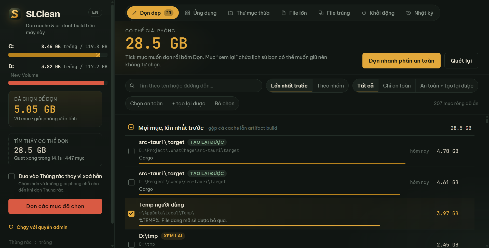
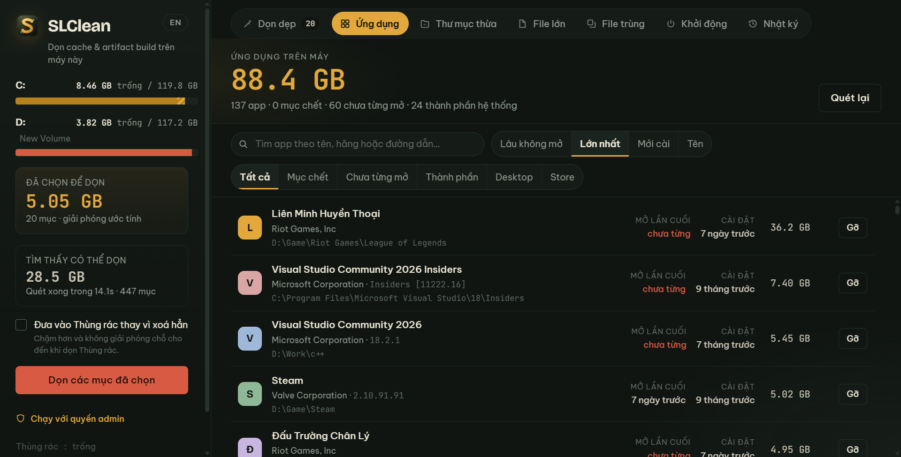
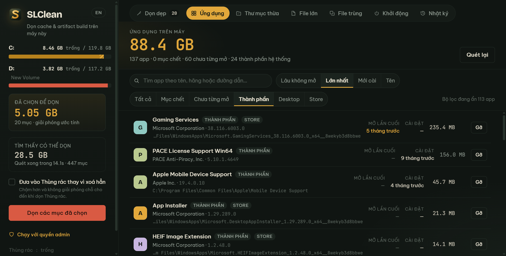
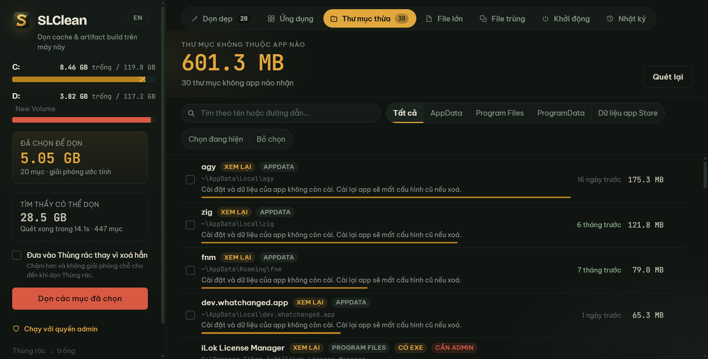
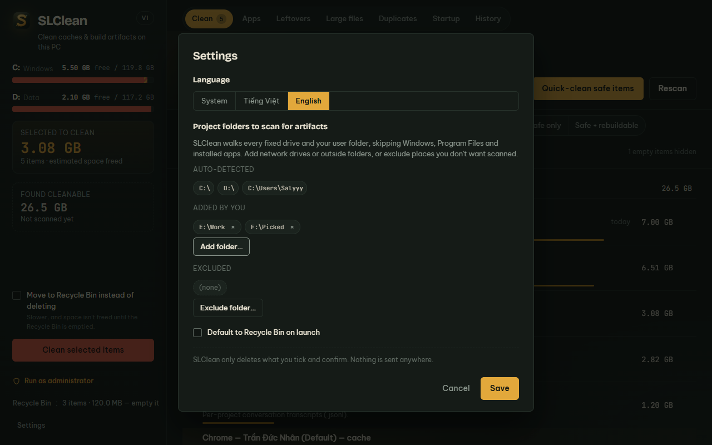
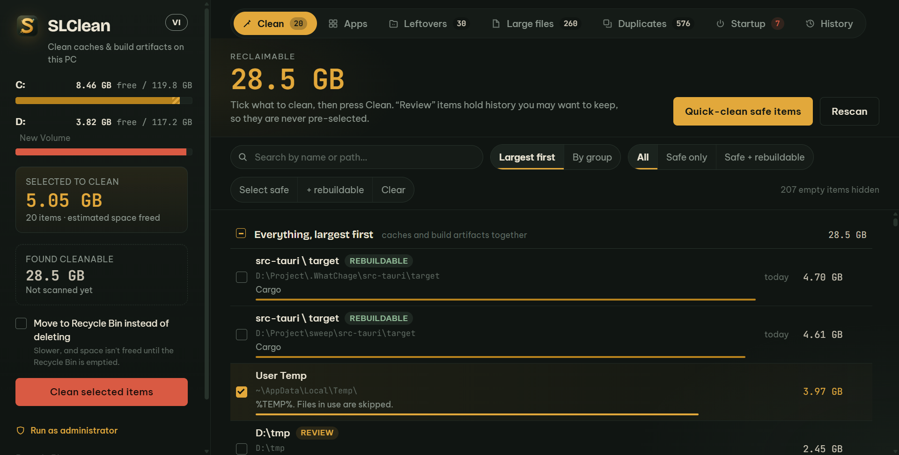

# SLClean

[English (README.md)](README.md) | [Tải bản mới nhất (Releases)](https://github.com/SalyyS1/SLClean/releases)

Xem ổ đĩa Windows của bạn thật sự chứa gì, rồi lấy lại chỗ mà không phải đoán: cache và
artifact build, app lâu không mở, thư mục app đã gỡ để sót, file đơn lẻ nặng nhất, file trùng
nhau từng byte, mục tự chạy cùng Windows, và nhật ký cho biết cái gì đã phình ra từ lần trước.
Desktop app (Tauri 2 + Rust), song ngữ Việt/Anh, không quảng cáo, không gửi dữ liệu đi đâu, và
không có bước nào tự xoá: bạn tick, bạn xác nhận, rồi nó mới xoá.

**Tải bản dùng ngay** ở trang [Releases](../../releases): `SLClean_<version>_x64-setup.exe`
(bộ cài, cho user hiện tại, không đòi admin) hoặc `SLClean-portable.exe` (chạy không cần
cài). File chưa ký số nên Windows SmartScreen hỏi lần đầu: chọn *More info → Run anyway*.

*English:* see what is actually on your Windows drives, then reclaim it without guessing —
caches and build artifacts, apps you never open, folders left behind by uninstalled apps, your
heaviest single files, byte-identical duplicates, what starts with Windows, and a history that
tells you what grew since last time. Tauri 2 + Rust desktop app, Vietnamese/English UI, no ads,
no telemetry, and nothing is deleted until you tick it and confirm. Grab the installer or the
portable exe from [Releases](../../releases); the binary is unsigned, so SmartScreen asks once.



## Bảy tab

| Tab | Làm gì |
|---|---|
| **Dọn dẹp** | Cache, thư mục tạm và artifact build trên mọi ổ, xem **Theo dự án (`.git`)**, xuất báo cáo **HTML/CSV**, dải tổng quan an toàn, phân loại chi tiết. |
| **Ứng dụng** | Mọi app đã cài kèm lần mở cuối theo Windows ghi. Gỡ app, hoặc xoá mục "chết" mà Settings không gỡ được. |
| **Thư mục thừa** | Thư mục trong AppData/ProgramData/Program Files app đã gỡ để sót, tích hợp **Trợ Lý Quyết Định Rác AI / Test & Bộ Cài Thừa (`SLC016–SLC018`)** (nhật ký/tạm Claude/Codex/Cursor, `.pytest_cache`, `playwright-report`, `test-results`, file crash dump, worktree AI có chống xóa nhầm code chưa commit, bộ cài `.exe`/`.msi` cũ trong Downloads/Temp) gắn nhãn rõ **✓ XÓA AN TOÀN / ⚠ XEM LẠI / 🛡 NÊN GIỮ** kèm lý do chi tiết và nút **Chọn Xóa An Toàn 1-click**, cùng **Bộ quét vệ sinh (`SLC010`)**. |
| **File lớn** | File đơn lẻ từ ngưỡng trở lên, kèm bản đồ thư mục và biểu đồ **Squarified Treemap** tương tác. |
| **File trùng** | Nhóm file giống hệt nhau từng byte, kèm nút chọn nhanh an toàn **Giữ bản mới nhất / Giữ bản cũ nhất** (luôn chừa lại ít nhất 1 bản gốc). |
| **Khởi động** | Mục tự chạy cùng Windows: Run, thư mục Startup, scheduled task. Bật/tắt không xoá. |
| **Nhật ký** | So hai lần quét, xuất **Báo cáo Sức khoẻ Ổ đĩa HTML 1 cú bấm (`Export Digest HTML`)**, và lưu **Sổ cái các lần dọn (Clean Run Ledger)** theo dõi tổng dung lượng đã giải phóng & lịch sử khôi phục Thùng rác. |

> **Cột mốc v0.57.0:** **MCP Server 40 công cụ chỉ-đọc duy nhất (`SLClean --mcp`)** (đủ bộ xuất HTML, SARIF v2.1.0 và Shields.io Badge), **Tab Khởi động hiển thị trực tiếp thời gian trễ mở máy & Hạng A–F kèm nút Xuất HTML/JSON**, **Huy hiệu Sức khoẻ Ổ đĩa (A–F) bấm được ở cột trái** xuất báo cáo HTML 1 cú bấm, **Xuất báo cáo HTML / CSV / JSON ở tab Dọn dẹp**, **Xuất báo cáo HTML Biến động Dung lượng (Drift) ở tab Nhật ký**, phím tắt **`Alt+1..7` / `Ctrl+K` / `F5` / `?`**, cùng bộ lệnh CLI không phá huỷ (`--doctor --fail-below-grade`, `--plan-cleanup`, `--audit-startup`, `--scan-extensions`, `--check-settings`, `--scan-projects`, `--scan-dupes`, `--scan-hygiene` SARIF v2.1.0).

> **Cột mốc v0.20.0:** Tích hợp **Stdio MCP Server 15 công cụ chỉ-đọc (`SLClean --mcp`)** bổ sung **`slclean_plan_safe_cleanup`** lập lộ trình dọn dẹp an toàn 4 bước, lệnh **`SLClean --doctor --report-html digest.html`** xuất báo cáo HTML sức khoẻ ổ đĩa từ dòng lệnh, **`slclean_inspect_settings`**, **`slclean_extension_breakdown`** + dải lọc đuôi file nhanh, **`slclean_audit_startup_entries`** + nhãn **Heavy boot / Updater**, **Xuất sổ cái CSV**, **Simple Mode** và phím tắt (`Ctrl+K`, `F5`).

Cột trái luôn hiện dung lượng trống từng ổ, tổng đã tick, chế độ Thùng rác và nút dọn — mục
cache, artifact và thư mục thừa dùng chung một nút đó. Tab **File lớn** và **File trùng** cũng
tick vào cùng giỏ ấy, nên một lần xác nhận dọn được cả bốn loại.

## Dọn dẹp


Con số lớn là tổng tìm thấy, thanh trái là tổng đã tick. Không mục nào bị xoá cho tới khi bạn
tick và bấm xác nhận; mục `xem lại` (có dữ liệu của bạn) không bao giờ tự tick.

Trong lúc quét, danh sách hiện ngay với nhãn `đang đo` và số tăng dần; con số lớn ở đầu bảng và
thanh mảnh bên dưới cho biết tiến độ. Quét xong, SLClean ghi một mốc cho tab Nhật ký.

### Cách xem và lọc

- `Lớn nhất trước` (mặc định): trộn cache lẫn artifact vào một danh sách, sắp theo dung
  lượng giảm dần. `Theo nhóm` chia theo nguồn.
- Ô tìm kiếm lọc theo tên, đường dẫn hoặc ghi chú; `Esc` để xoá.
- `Chỉ an toàn` / `An toàn + tạo lại được`: ẩn các mục còn lại. Mục đã tick không bao giờ bị
  ẩn. Mục rỗng cũng được ẩn cho gọn; dòng chữ bên phải cho biết đang ẩn bao nhiêu.
- `Dọn nhanh phần an toàn`: tick mọi mục an toàn đang hiện rồi mở thẳng hộp xác nhận.
- `Chọn an toàn` / `+ tạo lại được` chỉ tick trong phạm vi đang hiện và bỏ qua mục cần admin.
- Bấm bất kỳ đâu trên một hàng cũng tick được. Cách xem, bộ lọc, ngôn ngữ được nhớ lại.

### Cách phân loại

| Nhãn | Nghĩa | Tự tick |
|---|---|---|
| (không nhãn) | cache thuần, app tự tạo lại khi cần | có |
| `tạo lại được` | mất thì phải tải/build lại (`npm install`, `cargo build`, Gradle deps) | không |
| `xem lại` | có dữ liệu của bạn: transcript AI, backup, thư mục tạm cá nhân | không |
| `cần admin` | thư mục hệ thống, chỉ dọn được khi chạy elevated — ô tick bị khoá | không |
| `một phần` | có thư mục con không đọc được nên số đo thiếu | — |

### Những gì được quét

Không có đường dẫn nào ghi cứng theo máy. Mọi vị trí suy từ biến môi trường Windows
(`%LOCALAPPDATA%`, `%APPDATA%`, `%TEMP%`, `%SystemRoot%`, `%ProgramData%`) hoặc của công cụ
(`CARGO_HOME`, `GRADLE_USER_HOME`, `GOPATH`, `GOCACHE`, `PIP_CACHE_DIR`, `UV_CACHE_DIR`,
`PLAYWRIGHT_BROWSERS_PATH`…). Mục không tồn tại trên máy thì không hiện.

- **Công cụ AI:** Claude Code (transcript, file-history, shell snapshots, debug, todo,
  paste cache, temp), Codex CLI (sessions, log, archived), Orca, Gemini CLI, Hugging Face,
  PyTorch, Ollama, LM Studio, Playwright, Puppeteer, chrome-devtools-mcp.
- **Kho gói:** npm, pnpm, Yarn, Bun, Deno, pip, uv, Poetry, Cargo (registry cache/src, git),
  rustup downloads, Go (mod + build cache), Gradle (caches, daemon, wrapper, JDK tự tải),
  Maven, NuGet, Composer, pub, Scoop, Android, Electron, node-gyp, Cypress, Unity, Unreal DDC.
- **Trình soạn thảo:** mọi app họ VS Code phát hiện qua `User\workspaceStorage` (VS Code,
  Insiders, Cursor, Windsurf, Trae, VSCodium…): cache, VSIX đã tải, logs, workspaceStorage,
  lịch sử file cục bộ. JetBrains: từng sản phẩm dưới `%LOCALAPPDATA%\JetBrains`.
- **Trình duyệt:** *từng profile* của Chrome, Chrome Beta/Canary, Edge, Brave, Vivaldi,
  Chromium, Arc, Cốc Cốc, Opera/GX (Cache, Code Cache, GPUCache, Dawn, Service Worker) với
  tên profile lấy từ `Local State`; Firefox, Zen, Floorp, LibreWolf, Waterfox (cache2,
  startupCache, thumbnails). Đăng nhập, mật khẩu, bookmark không nằm trong các thư mục này.
- **Ứng dụng:** mọi app Electron có `Cache` + `Code Cache` dưới Roaming/Local (Discord,
  Claude Desktop, Slack, Figma, Notion, Blockbench, Termius…), Spotify, Telegram, Zoom,
  OneDrive logs, Adobe media cache, Remote Desktop, app Microsoft Store (`TempState`,
  `AC\INetCache`).
- **Game:** Steam (shader cache ở mọi thư viện đọc từ `libraryfolders.vdf`, tải dở, web
  cache), Minecraft launcher (webcache, logs, assets/libraries, versions), Modrinth, Prism,
  Epic.
- **Windows:** Temp người dùng, `Windows\Temp`, Windows Update Download, Delivery
  Optimization, CBS logs, WER, CrashDumps, D3DSCache, shader cache NVIDIA/AMD/Intel, driver
  NVIDIA đã tải, INetCache, thumbnail cache, Package Cache (Visual Studio).
- **Thư mục tạm ở gốc ổ đĩa và thư mục home:** `tmp`, `temp`, `*-temp`, `tmp-*`…
  (đánh dấu `xem lại`), `OneDriveTemp`/`WUDownloadCache`/`DeliveryOptimization` (an toàn),
  `$WinREAgent`/`$WINDOWS.~BT`/`Windows.old` (xem lại, cần admin).
- **Artifact build:** `node_modules`, `target` (cạnh Cargo.toml/pom.xml), `build`, `out`,
  `dist`, `bin`/`obj` (.NET), `.venv`, `__pycache__`, `.next`, `.nuxt`, `.turbo`, `.gradle`,
  `.kotlin`, `Library`/`Temp` (Unity), `cmake-build-*`, `run` (server test Paper)… Mỗi cái
  đối chiếu với dấu hiệu dự án bên cạnh để không nhầm thư mục trùng tên. Thư mục cài Node
  (nvm/fnm) và app Electron đã cài (`resources\app`, `.asar.unpacked`, msys, Program Files)
  không bao giờ bị coi là artifact.

Artifact được tìm trên **mọi ổ đĩa cố định và thư mục người dùng**, bỏ qua Windows, Program
Files, ProgramData, WindowsApps, Steam, msys, OneDrive và các thư mục `.x` trong home. Hộp
**Cài đặt** cho thêm thư mục (ổ mạng, ổ ngoài) hoặc loại trừ nơi không muốn quét.

## Ứng dụng



Liệt kê mọi app đã đăng ký với Windows: ba nhánh `Uninstall` trong registry (HKLM 64/32-bit,
HKCU) và app Store của user hiện tại (`AppModel\Repository\Packages`, tên `ms-resource:` được
dịch qua `SHLoadIndirectString`). Mỗi app có hãng, phiên bản, ngày cài, dung lượng thư mục cài
**đo thật** (số của trình cài chỉ dùng khi không có thư mục), và **lần mở cuối** theo Windows
ghi. Sắp theo lâu không mở / lớn nhất / mới cài / tên.

Lần mở cuối lấy từ UserAssist trong HKCU (không cần admin): mỗi lần mở app qua
Explorer/Start/Taskbar, Windows ghi số lần và giờ lần cuối, tên bị mã ROT13 và tiền tố Program
Files thay bằng GUID thư mục chuẩn. Windows ghi nhiều app theo AppUserModelID hoặc shortcut
`.lnk` chứ không theo exe, nên app đọc thêm shortcut Start Menu/Taskbar/Desktop (định dạng
MS-SHLLINK, không qua COM) để nối ID ↔ exe ↔ thư mục cài. App mở từ dòng lệnh hoặc tự chạy cùng
Windows có thể không có bản ghi: `chưa từng` = có thư mục cài mà không có bản ghi nào, `không
rõ` = registry không ghi thư mục cài (MSI hay bỏ trống `InstallLocation`) nên không đối chiếu
được. App đang chạy được nhận qua tiến trình.

**Thành phần chạy nền** (redistributable, runtime, SDK, driver, service, codec, extension…)
được tách thành nhóm riêng để không lẫn vào danh sách app đáng gỡ — trên máy thử, việc này đưa
24 mục ra khỏi nhóm "chưa từng mở", giảm 84 xuống 60:



Điều kiện tách: tên có từ khoá thành phần **và** không shortcut nào ở Start Menu/Taskbar/Desktop
trỏ vào thư mục cài, tức Windows không cho bạn lối mở nào. Nhóm này không tính vào `chưa từng
mở`, xếp cuối danh sách và hiện `—` ở cột lần mở, vì gỡ chúng có thể làm app khác hỏng. Điều
kiện shortcut giữ lại app tên nghe như thành phần nhưng vẫn mở được (ví dụ `Visual Studio
Installer`). Lọc riêng bằng chip `Thành phần`.

- **Gỡ** luôn chạy trình gỡ của chính hãng (nó tự xin UAC nếu cần) hoặc `Remove-AppxPackage`
  với app Store; xong app kiểm tra lại registry và đề nghị xoá thư mục cài còn sót.
- **Mục chết** là mục mà trình gỡ (exe) đã mất, thường do xoá tay thư mục app: Settings của
  Windows không gỡ được nữa, nút `Xoá mục` xoá khoá registry đó (kèm thư mục sót nếu chọn).
  Mục dưới HKLM cần chạy với quyền admin; MSI không bao giờ bị coi là chết vì `msiexec` gỡ
  theo mã sản phẩm.

## Thư mục thừa



Thư mục con trực tiếp của `AppData\Local`, `Roaming`, `LocalLow`, `ProgramData`, `Program
Files (x86)`, `Local\Programs` và `Local\Packages` mà **không app đã cài nào nhận**: không app
nào trỏ thư mục cài vào đó, tên thư mục không khớp tên/hãng app nào (đã chuẩn hoá, kể cả tên
gói Store và exe đã chạy 6 tháng qua), không có tiến trình chạy từ đó. Thư mục Windows, tool
dev và mọi thứ đã có mục riêng trong tab Dọn dẹp không bao giờ được nêu.

Mỗi mục có nhãn vùng, `có exe` (app portable, xem kỹ) và lần mở cuối nếu Windows từng ghi; mục
trong Program Files/ProgramData cần admin. Tick rồi dọn bằng nút ở thanh trái như mục cache, cả
thư mục bị xoá (không giữ gốc). Đây là heuristic: luôn xem tên trước khi tick.

## File lớn


Sổ cái chỉ đo được cả thư mục, nên một file 4 GB nằm lẻ trong Downloads không bao giờ lộ ra.
Tab này đi một lượt qua mọi ổ và trả về hai thứ cùng lúc: danh sách file từ ngưỡng trở lên
(mặc định 100 MB, đổi được), và bản đồ dung lượng theo thư mục ba cấp đầu để lần ra chỗ chứa:


Đây là file của bạn, không phải rác, nên **không mục nào được tự tick**. Bản đồ cộng cả file
nhỏ nên tổng của nó lớn hơn danh sách file. File Windows tự quản (`pagefile.sys`,
`hiberfil.sys`, `swapfile.sys`, `dumpstack.log`) vẫn được nêu để giải thích chỗ trống đi đâu
nhưng bị khoá không cho tick — muốn bỏ thì tắt tính năng tương ứng của Windows, đừng xoá tay.
Thư mục không đọc được vì thiếu quyền được đếm và báo lại để bạn biết kết quả còn thiếu.

Quét không cần admin và không phụ thuộc NTFS nên chạy được cả ổ ngoài và ổ mạng, đổi lại phải
đi từng thư mục nên chậm hơn công cụ đọc thẳng bảng MFT — vì vậy nó chạy nền, phát dần kết quả
và huỷ được bất cứ lúc nào.

## File trùng


Chỉ nhóm file **giống hệt nhau từng byte**, không đoán theo tên hay ảnh trông giống nhau: gom
theo cỡ → băm 4 KB đầu → băm SHA-256 toàn file. File chỉ có một mình ở cỡ của nó thì không bao
giờ bị đọc, và file 4 GB được băm theo khối chứ không nằm hết trong RAM. Ngưỡng mặc định 1 MB
(đổi được): bản sao của file nhỏ thì nhiều vô kể mà chẳng lấy lại được bao nhiêu chỗ.

Bỏ qua những nơi mà trùng nhau là **đúng thiết kế**: mã nguồn và kho gói của công cụ lập trình
(`node_modules`, `.git`, `.cargo`, `.gradle`, `.m2`, `.nuget`, `.venv`…) — một jar nằm trong
mười cache Gradle là bình thường, muốn lấy lại chỗ thì dọn cả cache ở tab Dọn dẹp chứ không xoá
lẻ từng file rồi hỏng build. Cũng bỏ qua vùng do chương trình quản (Program Files, ProgramData,
AppData, thư mục Windows): đo trên máy thật thì đó là 1556 nhóm, phần lớn là hai bản Edge cài
song song, runtime và bản build cũ của app — xoá là hỏng app.

App **không tick hộ bạn bản nào**. Nhãn `cũ nhất` / `mới nhất` / `cùng thư mục` chỉ là gợi ý để
quyết nhanh; nếu bạn tick cả mọi bản trong một nhóm, app cảnh báo rằng dọn xong là mất hẳn file
đó.

## Khởi động


Mục tự chạy cùng Windows từ ba nguồn: khoá `Run` (HKCU, HKLM, HKLM WOW64), thư mục Startup (của
bạn và của mọi người dùng), và scheduled task có trigger lúc đăng nhập/khởi động. Mỗi mục hiện
**lệnh đầy đủ** như đã đăng ký, nguồn, và lần mở cuối của exe đích nếu Windows từng ghi.

Bật/tắt (không xoá) đúng cách Task Manager làm: ghi cờ vào `Explorer\StartupApproved\*` cho Run
và thư mục Startup, `schtasks /Change` cho task. Mục đã tắt vẫn nằm nguyên trong registry nên
bật lại lúc nào cũng được, kể cả bằng Task Manager.

Lọc theo `Đang bật`, `Lâu không dùng`, `Hỏng`. Mục `hỏng` là lệnh trỏ tới file không còn trên
máy — nó không chạy được nữa, chỉ nằm đó gây rối, và có nút `Xoá mục` riêng. Mục chạy từ thư
mục Windows được dán nhãn `của Windows`; mục ở phạm vi máy cần quyền admin để sửa.

## Nhật ký


Sau mỗi lần quét trọn vẹn, SLClean ghi một mốc gồm dung lượng trống của từng ổ và cỡ của từng
mục quét được. Chọn hai mốc để xem **cái gì đã ăn ổ đĩa từ lần trước** — thứ mà một lần quét
đơn lẻ không trả lời được. Lọc theo `Phình ra`, `Nhỏ lại`, `Mới xuất hiện`.

Giữ tối đa 60 mốc; quét lại trong vòng một giờ thì thay mốc cũ chứ không thêm mốc mới. Nhật ký
nằm ở `%APPDATA%\vn.salyyy.slclean\history.json`, không gửi đi đâu. Mục "mới xuất hiện" thường
do bạn vừa thêm thư mục quét chứ không phải dung lượng thật tăng.

## Cài đặt



Ngôn ngữ (theo hệ thống / Việt / Anh), thư mục quét thêm hoặc loại trừ, và chế độ Thùng rác.
Cài đặt lưu ở `%APPDATA%\vn.salyyy.slclean\settings.json`. Không có gì được gửi đi đâu.

Toàn bộ giao diện có bản tiếng Anh, đổi ngay không cần mở lại app:



## Quyền admin

Nút `Chạy với quyền admin` ở góc dưới trái mở lại app qua UAC rồi tự đóng bản hiện tại. Khi
chưa elevated, các mục `cần admin` (dưới `%SystemRoot%`, `%ProgramData%`, `$WinREAgent`,
`$WINDOWS.~BT`, `Windows.old`, thư mục thừa trong Program Files/ProgramData, mục chết dưới
HKLM, mục khởi động phạm vi máy) bị khoá thay vì báo lỗi lúc dọn.

## Chạy từ mã nguồn

Cần Rust (stable, MSVC) và Node 18+. Lần đầu chạy `npm install` để lấy Tauri CLI.

```
run-slclean.cmd
```

Hoặc trực tiếp: `src-tauri\target\debug\slclean.exe`. App tự quét tab Dọn dẹp khi mở (khoảng
15 s trên máy có ~450 mục; lần đầu có thể lâu hơn vì Windows chưa cache metadata). Các tab File
lớn, File trùng, Khởi động chỉ quét khi bạn mở chúng lần đầu.

Bản cài đặt (.exe NSIS, không cần Rust để chạy):

```
npm run build          # = npx tauri build; cần ~2 GB trống cho thư mục build
```

Kết quả ở `src-tauri\target\release\bundle\nsis\SLClean_<version>_x64-setup.exe`, cạnh đó là
`src-tauri\target\release\slclean.exe` chạy không cần cài. Cài cho user hiện tại, không đòi
admin. Nếu ổ chứa dự án chật, trỏ thư mục build sang ổ khác trước khi chạy lệnh trên:

```
set CARGO_TARGET_DIR=C:\tmp\slclean-release-out
```

khi đó kết quả nằm ở `C:\tmp\slclean-release-out\release\...`. Để phát hành,
`powershell -File scripts\make-release-bundles.ps1` làm trọn bước này rồi gom bộ cài, exe
portable và `SHA256SUMS.txt` vào `release\`; đính ba file đó lên GitHub Release.

## Giới hạn đã biết

- File đang mở bị bỏ qua và báo số lượng, không làm hỏng cả mục.
- Đường dẫn được bảo vệ (gốc ổ đĩa, `%SystemRoot%`, gốc Program Files và các thư mục
  Windows/Microsoft/runtime bên trong, gốc ProgramData, thư mục home và các thư mục con
  chính, tool home như `.cargo`/`.gradle`/`.claude`, `.ssh`, WindowsApps) bị từ chối ngay cả
  khi UI gửi lên. Thư mục app của hãng thứ ba trong Program Files thì dọn được (thư mục thừa).
- Lần mở cuối chỉ biết những gì Windows ghi vào UserAssist; app chạy từ terminal, từ
  launcher khác, hoặc bằng tài khoản khác không có bản ghi. Tab Thư mục thừa là heuristic
  theo tên: một thư mục của app portable đặt tên khác app có thể bị liệt kê, nên xem trước
  khi tick.
- File lớn và File trùng đi từng thư mục nên chậm hơn công cụ đọc thẳng bảng MFT của NTFS; đổi
  lại không cần admin và chạy được cả ổ không phải NTFS. File trùng cố ý không xét vùng do
  chương trình quản (Program Files, ProgramData, AppData) — bản trùng ở đó gần như luôn là cố ý.
- Tab Nhật ký cần ít nhất hai mốc mới so được, tức phải quét xong ít nhất hai lần cách nhau
  trên một giờ.
- Chưa có lịch dọn tự động và chưa có bản macOS/Linux (mã Rust có phần Windows-only: UAC,
  registry, UserAssist, single-instance qua Win32).

## Giấy phép

MIT (xem `LICENSE`). Dùng, sửa, phân phối lại tuỳ ý, kể cả trong môi trường thương mại, chỉ
cần giữ dòng bản quyền.

## Cấu trúc

```
src-tauri/src/
  lib.rs              lệnh Tauri + event stream (catalog/artifact/clean/big/dup/startup progress)
  catalog.rs          kiểu CatalogEntry (đa đường dẫn, nhãn 2 ngôn ngữ), Roots từ biến môi trường, dedupe
  catalog_specs.rs    bảng mục tĩnh (~95 vị trí đã biết)
  catalog_dynamic.rs  mục sinh theo máy: profile trình duyệt, app Electron, họ VS Code, JetBrains, Steam, Store, temp ở gốc ổ
  project_roots.rs    gốc quét artifact: mọi ổ + home, danh sách chặn, thêm/loại trừ từ cài đặt
  artifacts.rs        tìm node_modules/target/build… theo dấu hiệu dự án bên cạnh
  sizer.rs            đo dung lượng bằng read_dir (không stat thêm từng file), báo tiến trình
  cleaner.rs          xoá thẳng hoặc qua Thùng rác + danh sách đường dẫn bảo vệ
  settings.rs         settings.json (ngôn ngữ, thư mục thêm/loại trừ, chế độ Thùng rác)
  recycle_bin.rs      Thùng rác qua SHQueryRecycleBin/SHEmptyRecycleBin: một lời gọi, không liệt kê từng mục
  registry.rs         đọc/xoá registry qua advapi32 (mở khoá, liệt kê, chuỗi/số/nhị phân, giờ ghi cuối, xoá nhánh)
  installed_apps.rs   app desktop từ ba nhánh Uninstall; tách lệnh gỡ, ngày cài, mục "chết", chạy trình gỡ, xoá khoá
  store_apps.rs       app Store của user (AppModel Repository), dịch tên ms-resource, Remove-AppxPackage
  user_assist.rs      lần mở cuối từ UserAssist (ROT13, GUID thư mục chuẩn, bản ghi 72 byte), cả khoá exe lẫn .lnk
  shortcuts.rs        đọc .lnk (MS-SHLLINK): đích + AppUserModelID; chỉ mục Start Menu/Taskbar/Desktop để nối ID ↔ exe
  apps.rs             gộp desktop + Store thành AppInfo (lần mở, đang chạy, thư mục), gỡ app, xoá mục chết
  leftovers.rs        thư mục không app nào nhận: chủ sở hữu (thư mục cài, từ khoá tên/hãng), danh sách không bao giờ nêu
  big_files.rs        một lượt đi cây trả cả danh sách file ≥ ngưỡng và bản đồ dung lượng theo thư mục; file Windows tự quản bị khoá
  duplicates.rs       nhóm file giống hệt từng byte: cỡ → 4 KB đầu → SHA-256 toàn file; bỏ vùng mà trùng là đúng thiết kế
  startup.rs          mục Run/thư mục Startup/scheduled task; bật tắt qua cờ StartupApproved và schtasks
  history.rs          mốc dung lượng sau mỗi lần quét (history.json, giữ 60 mốc, gộp trong một giờ) + so hai mốc
  elevation.rs        kiểm tra elevated + mở lại qua UAC
  single_instance.rs  một bản chạy mỗi lần; --after-pid khi chuyển sang admin
  drives.rs           ổ đĩa cố định qua sysinfo
  parallel.rs         pool thread cố định dùng chung cho các pha quét
ui/
  index.html                      bố cục (rail trái, thanh bảy tab, các pane, hộp cài đặt/xác nhận/hỏi)
  js/i18n-strings.js              chuỗi vi/en, t(), L(), applyI18n()
  js/format-bytes-and-dates.js    định dạng dung lượng và mốc thời gian dùng chung
  js/ledger-view-and-rows.js      tạo hàng, hai cách xem, bộ lọc, tìm kiếm, tính tổng (cả mục thư mục thừa)
  js/tabs-and-ask-dialog.js       chuyển tab (nhớ tab), huy hiệu, hộp hỏi chung ask(), lớp bận
  js/apps-tab.js                  tab Ứng dụng: sắp/lọc/tìm, đo dần, gỡ, xoá mục chết (một hoặc tất cả)
  js/leftovers-tab.js             tab Thư mục thừa: quét lười, lọc theo vùng, chọn hết
  js/files-tab.js                 tab File lớn: ngưỡng, danh sách file và bản đồ thư mục, mục bị khoá
  js/duplicates-tab.js            tab File trùng: nhóm gập/mở, nhãn cũ nhất/mới nhất, cảnh báo tick cả nhóm
  js/startup-tab.js               tab Khởi động: bật/tắt, xoá mục hỏng, lọc theo trạng thái
  js/history-tab.js               tab Nhật ký: chọn mốc, so sánh, lọc phình/nhỏ/mới
  js/settings-dialog.js           hộp cài đặt, chọn thư mục qua dialog hệ thống
  js/slclean-app.js               quét, dọn, ổ đĩa, ngôn ngữ, sự kiện, ghi mốc nhật ký
  css/                            theo vùng giao diện; fonts.css sinh bởi scripts/fetch-google-fonts-offline.mjs
design/app-icon.html              nguồn icon (SVG); render → design/app-icon.png → `npx tauri icon`
```

Script kiểm thử và phát hành, tất cả chạy trên **app thật** mở qua cổng DevTools:

```
scripts/
  verify-ui-in-headless-chrome.mjs     UI với cầu nối __TAURI__ giả (i18n, tìm kiếm, cài đặt, dọn)
  launch-app-with-devtools-port.ps1    mở app thật với cổng DevTools
  drive-real-app-via-devtools.mjs      đọc số liệu thật từ DOM app đang chạy + chụp ảnh
  probe-real-app-settings-commands.mjs kiểm tra roundtrip settings trên app thật
  make-throwaway-artifact-fixture.ps1  dự án giả 3 MB trong D:\tmp
  make-throwaway-app-fixtures.ps1      mục Uninstall giả (một chết, một gỡ được) + thư mục mồ côi; -Remove để dọn
  make-throwaway-startup-fixture.ps1   mục Run/Startup giả (một hỏng) để thử bật/tắt/xoá
  e2e-delete-fixture-in-real-app.mjs   xoá thật fixture qua hộp xác nhận của app
  e2e-trash-mode-roundtrip-in-real-app.mjs  dọn fixture có/không tick Thùng rác, đếm Thùng rác từ shell Windows
  e2e-empty-recycle-bin-in-real-app.mjs     dọn Thùng rác từ app, kiểm tra cửa sổ còn trả lời
  measure-recycle-bin-command-in-real-app.mjs  đo lệnh Thùng rác trên app thật
  e2e-apps-and-leftovers-in-real-app.mjs    xoá mục chết, gỡ app giả, dọn thư mục sót; soi registry/đĩa sau mỗi bước
  e2e-large-files-in-real-app.mjs      quét file lớn, đổi ngưỡng, đổi cách xem, xoá một file fixture
  e2e-duplicates-in-real-app.mjs       tạo bản trùng thật, kiểm tra nhóm và cảnh báo tick cả nhóm
  e2e-startup-in-real-app.mjs          bật/tắt mục khởi động thật rồi soi cờ StartupApproved trong registry
  e2e-history-in-real-app.mjs          ghi hai mốc rồi kiểm tra bảng so sánh
  shoot-all-tabs-in-real-app.mjs       chụp mọi ảnh README trên app thật (bảy tab vi, tab Dọn dẹp en, hộp cài đặt)
  switch-real-app-language-and-capture.mjs  đổi ngôn ngữ trên app thật rồi chụp
  capture-running-app-window.ps1       chụp đúng cửa sổ app (không qua DevTools)
  make-release-bundles.ps1             build ra ổ khác, gom bộ cài + portable + SHA256SUMS vào release\
```

Test Rust: `cargo test --manifest-path src-tauri\Cargo.toml` — 74 test chạy mặc định (bảo vệ
đường dẫn, xoá file bị khoá, mục nhiều thư mục, đo song song, phân loại artifact, loại trừ,
dedupe danh mục, phân loại thư mục tạm, quyền admin, Thùng rác, registry, UserAssist, .lnk
(đích, AUMID, thư mục làm việc), tách lệnh gỡ, ngày cài, app Store, chủ sở hữu thư mục, nhận
diện thành phần hệ thống, ngưỡng/bản đồ file lớn, ba pha lọc file trùng, cờ StartupApproved,
gộp và cắt mốc nhật ký) và 7 test `--ignored` in ra dữ liệu của máy hiện tại để soi bằng mắt
(danh sách app, thư mục thừa, shortcut đọc được, mục khởi động). Test UI:
`node scripts/verify-ui-in-headless-chrome.mjs` (cần Chrome cài sẵn và `playwright-core` từ
`npm install`).
